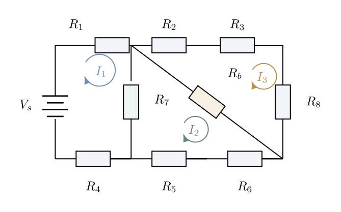

# Week 03 bridge-circuit extension — outline awaiting approval

Status: APPROVED FOR FULL GENERATION by user instruction "teruskan penjanaan semua slides". Subsequent human approval pauses waived by that instruction; parent QA retained.

Purpose: Explain the lecturer-requested 3×3 bridge-circuit derivation step by step. English slide text and presenter notes. This is an optional worked extension; it does not expand the ordinary-pass Week 03 2×2 requirements.

Delivery proposal: Six new slides inserted after the existing slide 13 (bridge self-activity), before the existing slide 14 (representation versus input change). Existing slides retained. The resulting lecture deck would contain 21 slides. The earlier 90-minute narration/Remotion timing remains a separate deliverable and is not revised by this slide-only request.

## Locked physical model

- Three clockwise mesh currents, ordered x=[I1; I2; I3]. I1 is the left face, I2 the lower triangular face, I3 the upper triangular face.
- Source Vs is in mesh 1, with its positive terminal at the top.
- Mesh 1 boundary: R1, R4, R7, Vs.
- Mesh 2 boundary: R7, R5, R6, Rb.
- Mesh 3 boundary: R2, R3, R8, Rb.
- R7 is shared by meshes 1 and 2. Rb is shared by meshes 2 and 3. Meshes 1 and 3 share no branch.
- All resistances remain symbolic. No invented component values or computed numerical outputs.

## Extension slide 1 — Identify three meshes and two shared branches

- Key points: one unknown per mesh; clockwise reference directions; shared R7 and Rb; no direct I1–I3 shared branch.
- Visual: large canonical network with short mesh-boundary labels; current differences attached to the correct shared branches.
- Role: physical model and sign convention.
- Required strict source image: preserve topology, resistor labels, mesh positions, and clockwise arrow directions.

## Extension slide 2 — Derive the left-mesh equation

- Key points: private drops R1 I1 and R4 I1; shared drop R7(I1−I2); source rise Vs; expand into row 1.
- Strict content:
  - R1 I1 + R4 I1 + R7(I1−I2) = Vs
  - (R1+R4+R7)I1 − R7 I2 + 0 I3 = Vs
  - Row 1: [R1+R4+R7, −R7, 0]
- Visual: highlight the left mesh on the same network; connect each boundary term to the expanded equation.
- Role: guided derivation and first coefficient row.
- Required images: canonical bridge circuit above as strict input; an exact equation reference will be prepared from the locked content after outline approval.

## Extension slide 3 — Derive the lower-mesh equation

- Key points: traverse R7 in mesh-2 direction; private R5/R6; traverse Rb in mesh-2 direction; no source.
- Strict content:
  - R7(I2−I1) + R5 I2 + R6 I2 + Rb(I2−I3) = 0
  - −R7 I1 + (R7+R5+R6+Rb)I2 − Rb I3 = 0
  - Row 2: [−R7, R7+R5+R6+Rb, −Rb]
- Visual: highlight lower triangular face; label the two shared current differences separately.
- Role: guided derivation with two couplings.
- Required images: canonical bridge circuit as strict input; exact equation reference from the locked content.

## Extension slide 4 — Derive the upper-mesh equation

- Key points: private R2/R3/R8; shared drop Rb(I3−I2); no direct I1 term; no source.
- Strict content:
  - R2 I3 + R3 I3 + R8 I3 + Rb(I3−I2) = 0
  - 0 I1 − Rb I2 + (R2+R3+R8+Rb)I3 = 0
  - Row 3: [0, −Rb, R2+R3+R8+Rb]
- Visual: highlight upper triangular face; show why the I1 coefficient is zero.
- Role: complete the third equation and row.
- Required images: canonical bridge circuit as strict input; exact equation reference from the locked content.

## Extension slide 5 — Assemble the three equations into A*x=b

- Key points: rows retain equation order; columns retain I1/I2/I3 order; b=[Vs;0;0]; units Ω×A=V.
- Strict content:
  - A = [R1+R4+R7, −R7, 0; −R7, R7+R5+R6+Rb, −Rb; 0, −Rb, R2+R3+R8+Rb]
  - x = [I1; I2; I3]
  - b = [Vs; 0; 0]
- Visual: large readable complete symbolic system with consistent row/column alignment and unit annotations.
- Role: representation mapping.
- Required image: exact full-matrix reference prepared from the locked content. The old generic bridge_matrix_scaffold.png is not a completed derivation and must not replace the full matrix.

## Extension slide 6 — Check every coefficient against the circuit

- Key points: diagonal is the resistance sum around that mesh; off-diagonal is negative shared resistance for these clockwise references; zeros mean no shared branch; substitute any computed solution into all three original KVL equations.
- Visual: circuit inset beside selected entries A12=A21=−R7, A23=A32=−Rb, A13=A31=0; concise direct-substitution check cue.
- Role: physical audit and validation transfer.
- Required images: canonical bridge circuit as strict input; exact matrix-entry reference from the locked content.

## Proposed sample after the remaining approvals

Extension slide 3 is representative: it tests the circuit highlighting, two distinct shared-current differences, exact KVL expansion, and readable matrix-row mapping.

## Pending gates

1. Lecturer approval of six-slide outline, insertion position, optional-extension status, and circuit/equation source mapping.
2. Retain the course Teaching Courseware visual direction; confirm image backend as required by the skill.
3. Generate exactly one representative sample for approval.
4. After sample approval, use one exact-match inherited-model subagent per remaining slide; record dispatch, results, scientific QA, notes, and assembly evidence.
